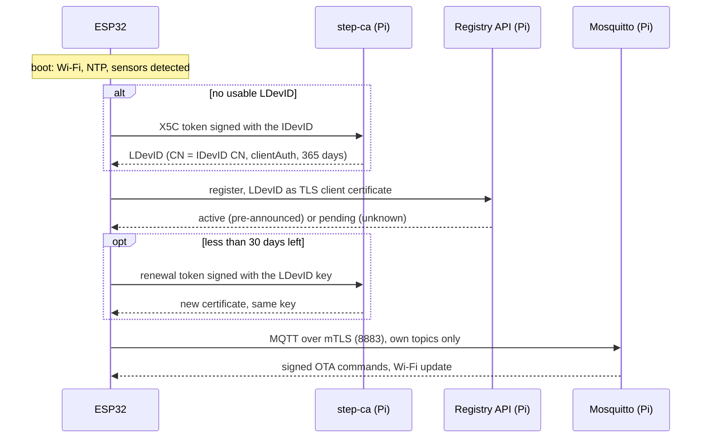

# HomePi firmware — ESP32 devices with hardware-rooted identity and signed OTA

Firmware for the ESP32 devices of [HomePi](https://github.com/LouisAndreN/homepi-infra): five
environmental sensors (ESP32-C3), an LED strip controller and a NILM energy bridge. ESP-IDF 5.3, C.

## What every device does



| Component | Role |
|---|---|
| `components/homepi_identity` | IDevID → LDevID (IEEE 802.1AR model): enrolment through the step-ca X5C provisioner, registration with the LDevID as client certificate, renewal at boot |
| `components/homepi_ota` | Signed OTA: manifest (project, chip, version, SHA-256) verified with an ECDSA P-256 public key compiled into the image; strictly newer versions only; bootloader rollback when a new image never confirms itself |
| `components/homepi_common` | Status LED patterns and NTP sync shared by the three applications (time from the Pi only: the IoT network has no route to the Internet for NTP) |
| `homepi_sensor`, `homepi_led`, `homepi_nilm` | The three applications (sensor auto-detection, telemetry, commands) |
| `fleet/devices.csv` | Which project each device runs, declared, never guessed |
| `tools/ota-sign.sh` | Builds from a signed tag, signs the manifest with the offline key, verifies the signature against the key compiled into that image |
| `tools/usb-flash.sh` | USB flash of the application only; the identity and Wi-Fi partition (NVS) is never written |

## Design decisions

| Decision | Rejected alternative | Why |
|---|---|---|
| A broker outage never discards the certificate | Re-enrol after three MQTT disconnects (firmware up to v2.3) | That loop signed 232 certificates in one day and let a revoked device come back with its IDevID |
| Renewal at boot, before MQTT | Renew at run time | An ESP32-C3 cannot hold a second TLS session next to the MQTT one (`MBEDTLS_ERR_SSL_ALLOC_FAILED`, seen on a canary) |
| OTA signing key on the operator's laptop | Sign on the Pi | The Pi only relays what was signed: a compromised Pi cannot push firmware |
| No eFuse features (Secure Boot, flash encryption, DS peripheral) | Burn eFuses | Irreversible on prototype hardware. Accepted risk: with physical access, the IDevID key can be read and used to obtain an LDevID for that one device name, until it is revoked |

## How this firmware is built

The code is written with Claude (Anthropic's AI model), which is why some commits show `Claude` as
author. I (Louis) decide the design, flash and test on the real devices, and sign every release
tag and every OTA manifest with keys that never leave my laptop.

## Build

```bash
. $IDF_PATH/export.sh
cd homepi_sensor && idf.py build
```

Device identity (IDevID and Wi-Fi) is written once over USB at the bench and never committed:
`wifi_secrets.env`, generated NVS files and keys are ignored by Git.

## Status

Five sensors on v2.4.3 and the LED and NILM bridge on v2.4.2, all updated by signed OTA, with a
proven bootloader rollback. The NILM application is in development.

## License

Apache License 2.0, see [LICENSE](LICENSE).
